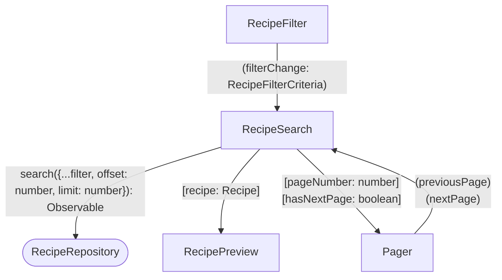
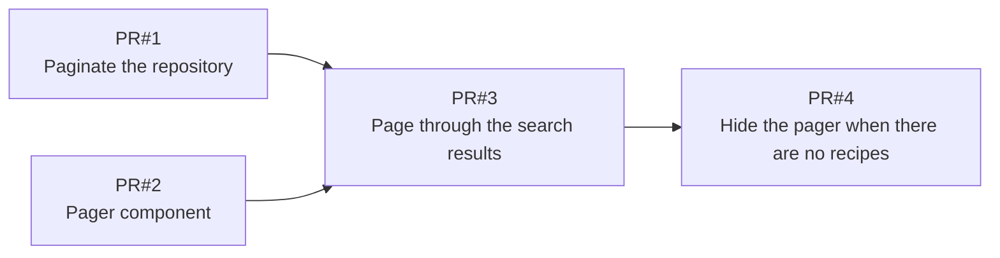

# Goals

- The catalog keeps growing and Search lists every match at once. Users scroll through long lists to find a recipe.
- Every search downloads the whole result set. The page gets slower as the catalog grows.
- Users browse the matching recipes a page at a time and always know which page they are on.

# Non-Goals

- No total count or "Page 2 of 5". The API returns the matching recipes only.
- No page size picker. Four recipes per page.
- No page in the URL. Reloading goes back to the first page.
- No infinite scroll or "Load more".
- No API changes. The recipe API already takes `offset` and `limit` as search query params.

# Desired Behavior

- [ ] Search shows at most four recipes at a time.
- [ ] A pager below the recipes shows Previous, the current page number, and Next.
- [ ] Next shows the next four recipes.
- [ ] Previous shows the previous four recipes.
- [ ] Previous is disabled on the first page. Next is disabled on the last page.
- [ ] Changing any filter goes back to the first page.
- [ ] The pager is hidden when there are no recipes. "No recipes found" is shown instead.

# Design

- `RecipeSearchParams` gets `offset` (defaults to 0) and `limit` (defaults to `null`, meaning no limit).
- `RecipeRepository.search` sends them to the API as is. `RecipeRepositoryFake.search` slices the matching recipes in memory.
- The repository contract covers `offset` and `limit`, so the fake and the real repository stay aligned.
- A `Pager` component in `shared/ui` shows Previous, the page number, and Next. It knows nothing about recipes or offsets.
- `Pager` takes `pageNumber` and `hasNextPage` as inputs, and emits `previousPage` and `nextPage`.
- `RecipeSearch` owns the `offset` signal. `PAGE_SIZE` is 4.
- `RecipeSearch` asks for `PAGE_SIZE + 1` recipes and shows the first `PAGE_SIZE`. The extra one tells whether there is a next page.
- The offset goes back to 0 whenever the filter changes.

## Diagram



# PR Plan



<details>
<summary>✅ PR#1 — Paginate the repository</summary>

## Tasks

```ts
export interface RecipeSearchParams {
  keywords: string;
  maxIngredientCount: number | null;
  maxStepCount: number | null;
  courses?: Course[];
  /** Index of the first recipe to return. */
  offset: number;
  /** Maximum number of recipes to return. `null` returns every recipe from `offset` on. */
  limit: number | null;
}
```

- [x] Add `offset` and `limit` to `RecipeSearchParams`. `createRecipeSearchParams` defaults them to 0 and `null`.
- [x] `RecipeRepositoryFake.search` applies the filters first, then skips `offset` recipes and returns at most `limit`.
- [x] `RecipeRepository.search` keeps sending the whole params to the API. The API already paginates.

## Testing Strategy

The repository contract runs against both the fake and the real repository.

### ✅ skips the first recipes when an offset is given

- Arrange the catalog with Hummus with Ful, Shakshuka, and Lemon and Ricotta Cheesecake.
- Search with `offset: 1`.
- Assert Shakshuka and Lemon and Ricotta Cheesecake are found, in that order.

### ✅ returns no more recipes than the limit

- Arrange the same catalog.
- Search with `limit: 2`.
- Assert Hummus with Ful and Shakshuka are found.

### ✅ returns the page at the offset

- Arrange the same catalog.
- Search with `offset: 1` and `limit: 1`.
- Assert only Shakshuka is found.

### ✅ filters before paginating

- Arrange the same catalog.
- Search with `keywords: 'a'`, `offset: 1`, and `limit: 1`.
- Assert only Lemon and Ricotta Cheesecake is found.

</details>

<details>
<summary>✅ PR#2 — Pager component</summary>

## Tasks

- [x] Add `Pager` to `shared/ui` with `pageNumber` and `hasNextPage` inputs, and `previousPage` and `nextPage` outputs. Export it from `index.ts`.
- [x] `Pager` shows Previous, "Page N", and Next.
- [x] Previous is disabled when `pageNumber` is 1. Next is disabled when `hasNextPage` is false.
- [x] `Pager` is not used by `RecipeSearch` yet.

## Testing Strategy

### ✅ shows the page number

- Mount `Pager` with `pageNumber: 2` and `hasNextPage: true`.
- Assert "Page 2" is shown.

### ✅ disables previous on the first page

- Mount `Pager` with `pageNumber: 1` and `hasNextPage: true`.
- Assert Previous is disabled.
- Assert Next is enabled.

### ✅ disables next when there is no next page

- Mount `Pager` with `pageNumber: 2` and `hasNextPage: false`.
- Assert Next is disabled.
- Assert Previous is enabled.

### ✅ emits previous page

- Mount `Pager` with `pageNumber: 2` and `hasNextPage: true`.
- Click Previous.
- Assert `previousPage` emitted exactly once.

### ✅ emits next page

- Mount `Pager` with `pageNumber: 1` and `hasNextPage: true`.
- Click Next.
- Assert `nextPage` emitted exactly once.

</details>

<details>
<summary>✅ PR#3 — Page through the search results</summary>

## Tasks

- [x] `RecipeSearch` keeps the `offset` and searches with `limit: PAGE_SIZE + 1`. It shows the first `PAGE_SIZE` recipes.
- [x] `RecipeSearch` shows `Pager` below the recipes. The page number starts at 1. There is a next page when the extra recipe came back.
- [x] Next adds `PAGE_SIZE` to the offset. Previous subtracts `PAGE_SIZE` from the offset.
- [x] The offset goes back to 0 whenever the filter changes.

## Testing Strategy

### ✅ shows the first four recipes

- Arrange the fake repository with five recipes.
- Mount `RecipeSearch`.
- Assert the first four recipes are shown.

### ✅ shows the next page

- Arrange the fake repository with five recipes.
- Mount `RecipeSearch`.
- Click Next.
- Assert only the fifth recipe is shown.
- Assert the page number is 2.

### ✅ goes back to the previous page

- Arrange the fake repository with five recipes.
- Mount `RecipeSearch`.
- Click Next, then Previous.
- Assert the first four recipes are shown.
- Assert Previous is disabled.

### ✅ disables next on the last page

- Arrange the fake repository with five recipes.
- Mount `RecipeSearch`.
- Click Next.
- Assert Next is disabled.

### ✅ disables next when every recipe fits on one page

- Arrange the fake repository with four recipes.
- Mount `RecipeSearch`.
- Assert Next is disabled.

### ✅ goes back to the first page when the filter changes

- Arrange the fake repository with five recipes whose names all contain "Recipe".
- Mount `RecipeSearch`.
- Click Next.
- Fill the Keywords field with "Recipe".
- Assert the first four recipes are shown.

</details>

<details>
<summary>✅ PR#4 — Hide the pager when there are no recipes</summary>

## Tasks

- [x] The pager is hidden when there are no recipes.

## Testing Strategy

### ✅ hides the pager when there are no recipes

- Arrange the fake repository with no recipe.
- Mount `RecipeSearch`.
- Assert "No recipes found" is shown.
- Assert there is no Previous and no Next button.

</details>

# Alternatives Considered

- **Return the total count from the API** to show "Page 2 of 5". Rejected. It needs a new response shape, and asking for one extra recipe is enough to know whether there is a next page.
- **Disable Next when the page is not full.** Rejected. When the match count is a multiple of four, Next leads to an empty page.
- **Infinite scroll or "Load more".** Rejected. Users lose track of where they are. Pages are enough.
- **Pager inside the `RecipeSearch` template.** Rejected. Two buttons and a page number are easier to test on their own, and `RecipeSearch` already has enough to do.
- **Pass `offset` and `limit` to `Pager`** and let it emit the next offset. Rejected. `Pager` would have to know about the extra recipe trick. Page number and "has next page" are enough.

# Kitchen Sink

## Risks

- The extra recipe is fetched twice: as the peek, then as the first recipe of the next page. Negligible.

## Future Plans

- Show the total count once the API returns it.
- Keep the page in the URL so it survives a reload.
