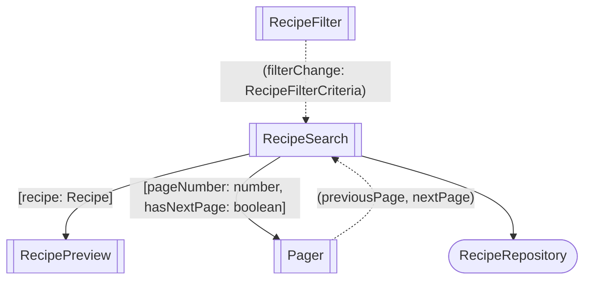
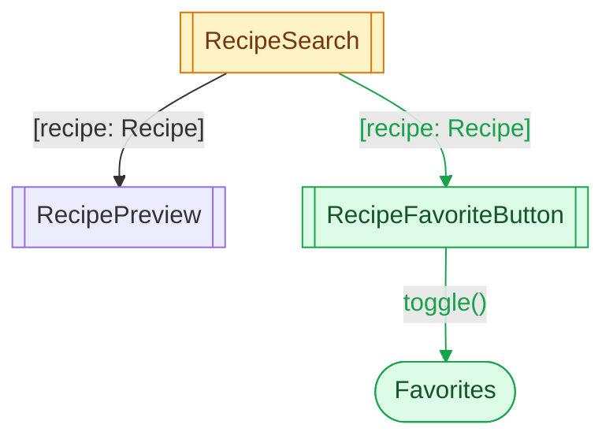

# Angular Mermaid Diagrams

A diagram answers one question, such as "how does the filter reach the repository?" or "what does this change touch?". Draw what answers it and nothing else. It is not an inventory of the code.

## Minimalism

- Pick the question first. If it is unclear, ask the user.
- Stay under about 7 nodes. Past that, split the diagram or collapse a subtree into one node.
- Leave out what does not answer the question: layout wrappers (cards, catalogs, navbars), Material and other third-party components, models, pipes, directives, `@if`/`@for`, routes, and private members.
- On an arrow, list only the inputs and outputs that matter. Drop the others.
- In a change diagram, draw the new and changed parts, plus only the direct neighbours that give them context.
- No subgraphs, legends, or extra styling. Add a subgraph only when a boundary is the point, such as a library the change crosses.

## Shapes

| Element                                           | Syntax       | Example                    |
| ------------------------------------------------- | ------------ | -------------------------- |
| Component                                         | `id[[Name]]` | `search[[RecipeSearch]]`   |
| Service                                           | `id([Name])` | `repo([RecipeRepository])` |
| Anything else that matters (backend, browser API) | `id[Name]`   | `api[Recipe API]`          |

Use the class name as the label and a short camelCase id. Never use a Mermaid keyword as an id: `end`, `graph`, `subgraph`, `class`, `style`, `click`, `default`.

## Arrows

| Relation                      | Arrow         | Label                                                          |
| ----------------------------- | ------------- | -------------------------------------------------------------- |
| Inputs, parent → child        | solid `-->`   | between brackets `"[recipe: Recipe, user: User]"`              |
| Outputs, child → parent       | dotted `-.->` | between parentheses `"(recipeChange: Recipe)"`                 |
| Injection, consumer → service | solid `-->`   | none, or the method when the call is the point `"addRecipe()"` |

- Always quote labels: `[]` and `()` are Mermaid syntax.
- One arrow per direction between two nodes. Put all the inputs in one label, and all the outputs in another: `"[pageNumber: number, hasNextPage: boolean]"`, `"(previousPage, nextPage)"`.
- An output without a payload has no type: `"(nextPage)"`.
- A `model()` is an input plus an `xChange` output. Draw the side the parent binds: `(filterChange)` is an output, `[filter]` an input, `[(filter)]` both.
- The arrow starts from the component whose template holds the binding, not from the DOM parent. A component projected through `<ng-content>` gets its inputs from the template that declares it.

## New and changed

Mark what a change adds or modifies, and leave the context uncolored.

```text
classDef new fill:#dcfce7,stroke:#16a34a,color:#14532d
classDef changed fill:#fef3c7,stroke:#d97706,color:#78350f
classDef removed fill:#fee2e2,stroke:#dc2626,color:#7f1d1d,stroke-dasharray:4 3
```

- Nodes: append the class, `fav[[RecipeFavoriteButton]]:::new`.
- Arrows: Mermaid has no class for links, so use `linkStyle` with the link's zero-based index in declaration order. Declare the colored links last so their indices are easy to count:

```text
linkStyle 2,3 stroke:#16a34a,color:#16a34a
linkStyle 4 stroke:#d97706,color:#d97706
```

- A new input on an existing component is a new or changed arrow, and the component is `changed`.
- After the diagram, say in one sentence what the colors mean, for example "Green is new, amber changes."

## Examples

How the search works:



`Catalog`, `NoRecipes`, and `RecipeAddButton` are left out: they do not change how the search works.

Adding a favorite button next to the ADD button:



Green is new, amber changes. `RecipePreview` is context: the button is projected into it, but `RecipeSearch` binds its input.

## Where the diagram goes

- In chat, a design doc, or a PR description: a fenced `mermaid` block. GitHub renders it.
- Next to the diagram, at most a few lines of prose. The diagram carries the structure, the prose carries the why.
