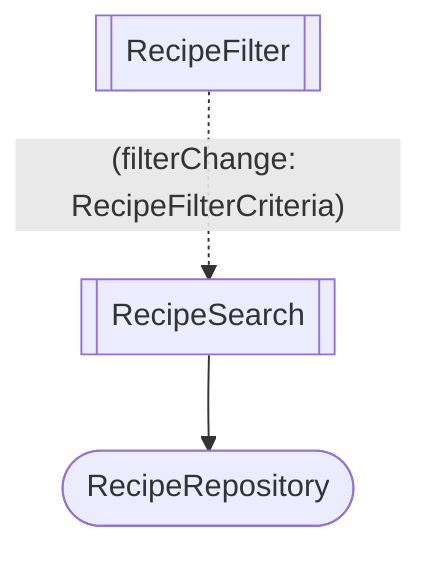

# Angular Mermaid Skill

## Prerequisites

🚨 Did you set up `pnpm`? Are you on the right branch?

👉 [Initial Setup](./000-setup.md)

## Setup

```sh
pnpm cook start 601-angular-mermaid-skill
```

Same code as the [404](./404-charted-autopilot.md) solution: `RecipeSearch` with the filter, the pager, and the ADD button.

## 🎯 Goal

Write a skill that makes the agent explain Angular code and planned changes with small diagrams you can read at a glance, drawn the same way every time.

## 📝 Steps

#### 1. Ask for a diagram without the skill.

```text
Draw a Mermaid diagram of how RecipeSearch works.
```

Paste the diagram in [mermaid.live](https://mermaid.live).

- How many nodes? Which ones would you drop?
- Can you tell a component from a service at a glance?
- Can you tell an input from an output?

#### 2. Write the skill.

Create `.claude/skills/angular-mermaid/SKILL.md`, with a `name` and a `description` in the frontmatter, then the rules:

- Components are subroutines: `search[[RecipeSearch]]`.
- Services are stadiums: `repo([RecipeRepository])`.
- Inputs go on a solid arrow from parent to child, between brackets: `"[recipe: Recipe, user: User]"`.
- Outputs go on a dotted arrow from child to parent, between parentheses: `"(recipeChange: Recipe)"`.
- In a change, new parts and parts to change get their own colors (`classDef`, plus `linkStyle` for arrows).
- Minimalistic: draw what answers the question, not an inventory of the code.

This is the notation you are after:



:::tip

- The `description` decides when the agent loads the skill. Say what it does and when to use it: explaining a feature, planning or reviewing a change, writing a design doc.
- One example diagram teaches more than ten rules.
- Mermaid reads `[]` and `()` as shapes, so labels need quotes.

:::

#### 3. Try it.

Start a new session and paste the prompt from step 1 again. Check every rule. Fix the skill, not the diagram, and try again.

#### 4. Diagram a change before the code.

```text
Add a meal plan panel next to the recipe search.
It lists the planned recipes, each with a REMOVE button.
Draw the change before you write any code.
```

- Is it obvious what is new, what changes, and what is only context?
- Did it leave out `Catalog`, `Card`, and the Material components?
- Would you approve this plan from the diagram alone?

#### 5. Check that it triggers on its own.

In a new session, ask a question that doesn't mention Mermaid or diagrams:

```text
Explain how clicking ADD reaches MealPlanner.
```

Does the agent load the skill? If not, rework the `description`.

#### 6. Debrief.

- Which rules did the agent follow from the start, and which needed an example?
- Where would these diagrams pay off: design docs, PR descriptions, reviews?
- What did you have to say explicitly to keep the diagrams small?

:::tip
The solution ships the skill in `.claude/skills/angular-mermaid/SKILL.md`: `pnpm cook solution`.
:::
